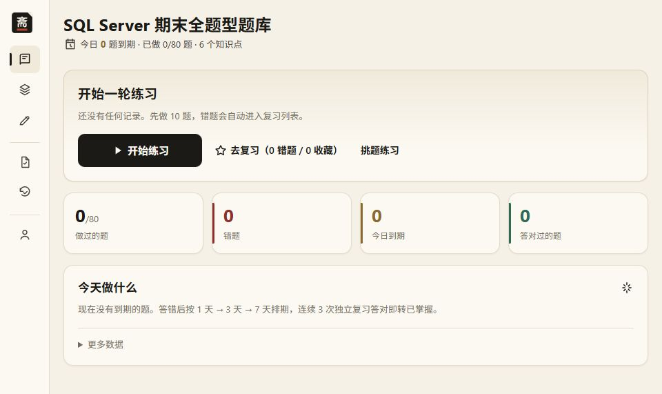

<p align="center">
  
</p>

<h1 align="center">题斋</h1>

<p align="center"><strong>把任何一份题目资料，变成你自己的刷题网站。</strong></p>

<p align="center">
  不预置题库 · 导入即用 · 本地优先 · 离线可刷<br />
  七种题型 · 错题复习 · 全真模考 · 多题库隔离
</p>



<p align="center"><sub>学习页：今天做什么、上次练到哪、错题与到期，一眼看清。</sub></p>

## 这是什么

题斋是一个**不预置题库**的通用刷题 Web 应用。

打开它时，没有广告，没有推荐，也没有别人的题库——只有一张干净的自习桌面。你把整理好的题目资料导入，它才真正成为你的题库：学习、练习、复习、模考，全都围绕你自己的资料展开。

它适合这些场景：

- **期末周**：把课件、习题和往年卷整理成一份题库，按知识点逐个击破。
- **考证 / 语言学习**：单选、完形、选词、阅读、翻译、作文都能装进来。
- **代码练习**：代码填空题可以在网页里直接挖空作答，按空判分。
- **只想安静做题**：不登录也能用，题库和进度只留在自己的浏览器里。

> 名字里的「斋」，是书斋的斋。不求热闹，只求一张能坐下来的书桌。

## 六个入口，一条完整的学习链路

| 入口 | 你会看到什么 |
| --- | --- |
| **学习** | 今天该做什么、上次练到第几题、正确率 / 到期 / 错题概览 |
| **题库** | 全部题目、搜索与筛选、答案与解析、按知识点查看讲义 |
| **刷题** | 按知识点、题型、题量组一轮练习；离开页面也能续上 |
| **模考** | 按模板组卷、倒计时、超时自动交卷、分题型成绩明细 |
| **复习** | 1 / 3 / 7 天到期复习、错题本、收藏、已掌握 |
| **我的** | 账号与登录、题库导入导出、学习记录备份、多题库管理 |

## 它好在哪

**题库是你自己的。** 题斋不替你做决定：不塞内置题库，不规定科目，也不把题目锁在某个平台里。题库包就是一份普通 JSON，可读、可改、可备份、可分享；同一份包，在电脑、手机、平板上导入都是同一套题。

**学习是有节奏的。** 答错后按 1 / 3 / 7 天排期回到你面前；连续 3 次独立答对才算「已掌握」；到期复习、错题本、收藏互不打扰。错题可以标错因、写备注，下次错得明白一点。

**打开就能用，关了也在。** 不登录时，题库、作答记录、练习进度全部保存在浏览器本地（IndexedDB），可随时导出 JSON 备份。安装成 PWA 后，断网也能继续刷；登录后还可以把学习记录和题库备份到云端，换设备恢复。

**该有的细节都有：**

- 七种题型：单选、多选、判断、填空、代码填空、简答（按采分点自评）、完形 / 选词 / 七选五。
- 题干与解析支持 Markdown、LaTeX 公式（KaTeX）与代码高亮。
- 阅读理解、完形填空共用同一篇材料，整卷只渲染一次。
- 导入校验宁可拒绝、不静默丢题：哪道题、哪个字段错了，直接指给你。
- 刷题可选题量、顺序 / 随机、知识点与题型；题库页支持搜索、筛选，`J` / `K` 连续翻题。
- 模考按模板组卷，限时模板倒计时、超时自动交卷；刷新页面后倒计时按绝对截止时间继续走。

## 三分钟开始

### 1. 打开网页

题斋是纯静态站点，构建后可以放在任意静态服务器、对象存储或内网机器上；仓库也支持 WorkBuddy「发布为应用」一键发布。

### 2. 导入一份题库

第一次打开时，首页会引导你导入题库包（`.json`）。也可以从「我的 → 数据导入导出 → 导入题库」进入。

还没有题库包？看下一节，用 AI 把现有文档转成题库。

### 3. 开始刷题

选好题库后，从「学习」页点「开始练习」；要整卷计时，就去「模考」；做错的题会自动进入「复习」。

## 题库从哪里来

### 用 AI 把文档转成题库包

把课件、习题、往年卷（Word / PDF / Markdown / 纯文本）交给任意 AI 助手，配合下面的转换提示词，让它直接输出可导入的题库包 JSON。

用法：复制提示词 → 粘贴给 AI → 在末尾附上文档内容 → 把返回的 JSON 保存为 `xxx.json` → 在题斋中导入。如果导入被拒绝，把报错原文贴回给 AI 让它修复。

<details>
<summary><strong>展开：题斋题库包转换提示词 v3（复制给 AI）</strong></summary>

````text
题斋题库包转换器 v3（契约版本 schemaVersion = 1）

你是题库数据转换器。请把我提供的文档内容转换为「题斋」的题库包 JSON。
只输出纯 JSON 本身：不要解释文字、不要 Markdown 代码块包裹，JSON 必须能通过下述全部校验规则。

【零、输出纪律】
1. 以文档为准：不捏造文档里没有的题目；答案、选项文字忠实于原文（可轻度规整格式，不改语义）。
2. 顶层只允许 kind / manifest / questions / knowledge / passages 五个字段，不多不少。
3. 题目与 manifest 上出现契约里没有的字段会被整包拒绝；讲义上多出来的字段只警告，但也不要依赖这一点。
4. 只输出 JSON，从 { 开始到 } 结束。

【一、顶层结构】
{
  "kind": "quiz.bank",
  "manifest": { …见【二】… },
  "questions": [ …见【三】【四】… ],
  "knowledge": [ …见【六】… ],
  "passages": [ …见【五】… ]
}
knowledge 与 passages 都可以为空数组；只有文档里确实有讲义 / 共享材料时才填写。

【二、manifest 题库清单】
{
  "schemaVersion": 1,
  "bankId": "小写英文/数字/下划线，如 os_final",
  "title": "题库标题",
  "subject": "科目名（可省略）",
  "questionCount": 与 questions 数组长度严格相等的整数,
  "topics": [
    { "topicId": "<bankId>:topic:001", "bankId": "同 manifest.bankId", "name": "知识点名称", "order": 0 }
  ],
  "examTemplates": [ …见【六】… ],
  "createdAt": "2026-01-01T00:00:00.000Z"
}
规则：
- topics 至少 1 个；按文档章节/知识体系划分，每道题必须归属至少一个 topicId。
- topicId 形如 <bankId>:topic:001，全包唯一。
- 不要输出上述清单以外的字段。

【三、每道题的共同字段】
{
  "schemaVersion": 1,
  "questionId": "<bankId>:<type>:<三位数以上序号，如 001>",
  "bankId": "同 manifest.bankId",
  "revision": "12 位小写十六进制，见下方说明",
  "topicIds": ["引用 manifest.topics 中的 topicId，至少 1 个"],
  "stem": "题干原文",
  "explanation": "解析（文档有才写，可省略）",
  "legacyKeys": [],
  "tags": ["可选：标签，如 <bankId>:tag:高频"],
  "difficulty": "可选：easy / medium / hard",
  "passageId": "可选：引用 passages 里的材料 ID（阅读理解等共享材料时必填）",
  "type": "题型名",
  …题型专属字段，见【四】
}
规则：
- questionId 的题型段必须与 type 一致（例如 os_final:single_choice:001 的 type 必须是 single_choice）。
- questionId 全包唯一，序号从 001 起连续补零。
- revision：恰好 12 位小写十六进制字符。推荐对「题干+答案」取确定性哈希（如 MD5 前 12 位）；无法精确计算时，可按题目顺序生成 000000000001、000000000002……（必须 12 位）。同一题内容不变时该值保持稳定。
- legacyKeys 固定输出 []。
- tags 与 difficulty 只在文档有明确依据时填写；没有就省略，不要给每道题都硬贴一个难度。
- 除以上字段与题型专属字段外，不要输出任何其它字段。

【四、题型专属字段与英语题型映射】

1) single_choice 单选
   "type": "single_choice",
   "options": [ { "optionId": "o1", "text": "选项A" }, { "optionId": "o2", "text": "选项B" } ],
   "answer": "o1"
   规则：至少 2 个选项；answer 是单个存在的 optionId。

2) multiple_choice 多选
   "type": "multiple_choice",
   "options": [ …至少 2 个… ],
   "answer": ["o1", "o3"]
   规则：answer 是 optionId 数组，至少 1 个。

3) true_false 判断
   "type": "true_false",
   "answer": true
   规则：布尔值；「对 / √ / 正确 / True」→ true，「错 / × / 错误 / False」→ false。

4) fill_blank 填空
   "type": "fill_blank",
   "stem": "题干中用 {{b1}}、{{b2}} 标出每个空位",
   "blanks": [ { "blankId": "b1", "accepted": ["标准答案", "等价写法"], "hint": "可省略" } ]
   规则：每个 blank 的 {{blankId}} 必须出现在 stem 中；accepted 至少 1 个写法。
   同一题干有多个空时，所有空都要出现在 stem 里，顺序与原文一致。

5) code_blank 代码填空
   "type": "code_blank",
   "files": [ { "fileId": "f1", "label": "Main.java", "language": "java",
                "code": "挖空后的代码，空位写成 ___(b1)___",
                "solutionCode": "完整答案代码，可省略" } ],
   "blanks": [ { "blankId": "b1", "fileId": "f1", "accepted": ["答案"] } ]
   规则：每个标记 ___(blankId)___ 必须出现在对应的 fileId 代码里；
   代码里出现的每个标记都必须有对应的 blank（不允许孤儿标记）。

6) short_answer 简答
   "type": "short_answer",
   "rubric": [ { "pointId": "r1", "text": "采分点描述", "score": 2 } ]
   规则：至少 1 个采分点，score > 0。参考答案拆成可逐条对照的采分点，不要写成一大段。

7) cloze 完形 / 选词 / 七选五（必须配合 passages）
   "type": "cloze",
   "passageId": "<bankId>:passage:001",
   "stem": "Tom is {{b1}} and Jerry is {{b2}}.",
   "sharedOptions": [ { "optionId": "o1", "text": "happy" }, { "optionId": "o2", "text": "sad" } ],
   "blanks": [ { "blankId": "b1", "optionId": "o1" }, { "blankId": "b2", "optionId": "o2" } ],
   "reuseOptions": false
   规则：
   - sharedOptions 至少 2 项；每个 blank 的 optionId 必须存在于 sharedOptions；
   - stem 必须包含每个 {{blankId}}，且空位不重复；
   - reuseOptions=false 表示「每个词只能用一次」（选词填空默认），
     同一选项填两个空会被拒绝；reuseOptions=true 表示允许复用（如七选五可重复的标记）。
   - 一道 cloze 只对应一篇材料；同一篇材料可以挂多道 cloze。

英语题型映射：
- 词汇/语法单项选择 → single_choice
- 多项选择 → multiple_choice
- 判断正误（True/False）→ true_false
- 单句词形转换 → fill_blank（每个空一组 accepted）
- 完形填空 / 选词填空 / 七选五 → cloze + passages（共享词库，材料只写一次）
- 阅读理解 → passages + 多道 single_choice（每题 passageId 相同）
- 翻译/句型转换 → short_answer（按「关键结构 + 关键词」拆采分点）
- 书面表达/作文 → short_answer（按内容要点、结构、语言拆采分点）
- 听力题不导入（应用无听力入口）。

【五、passages 共享材料】
材料是**题库级**内容，一篇文章只写一次，题目用 passageId 引用：
{
  "passageId": "<bankId>:passage:001",
  "title": "材料标题",
  "body": "Markdown 正文（段落、加粗、表格可用）",
  "source": "来源（可省略）"
}
规则：
- passageId 形如 <bankId>:passage:001，全包唯一；
- 只有「多道小题共享一篇材料」时才用 passages；普通单选题不要把材料塞进题干；
- 有 cloze 就必须至少有一篇 passages，且每道 cloze 的 passageId 都能对上；
- 阅读理解：一篇 passages + 多道 single_choice，每道题的 passageId 相同；
- 同一篇材料只输出一次，不要为每道小题复制一遍正文。

【六、knowledge 讲义（v2 新增规范）】
讲义数组的每一项是一篇，字段如下（summary / items / pitfalls / goals / sections / videos / resources 均可省略，省略即空）：
{
  "moduleId": "<bankId>:kb:001",
  "topicId": "必须是 manifest.topics 里存在的 topicId",
  "title": "讲义标题",
  "summary": "一句话概述（可省略）",
  "items": [ { "title": "要点标题", "detail": "一句话说明" } ],
  "pitfalls": ["易错点"],
  "goals": ["学完能做到什么（动词开头）"],
  "sections": [ { "title": "小节标题", "body": "Markdown 正文（表格/代码块可用）" } ],
  "videos": [ { "url": "课程视频地址", "title": "视频标题", "note": "对应本节哪部分", "startSec": 0 } ],
  "resources": [ { "title": "拓展阅读标题", "url": "https://…", "note": "可省略" } ],
  "estimatedMinutes": 25,
  "examFocus": "一句话说明考试里怎么考"
}
规则：
- moduleId 形如 <bankId>:kb:001，全包唯一；topicId 必须能在 manifest.topics 找到。
- 一篇讲义至少要有 items / sections / videos / resources 中的一项；四项全空会被拒绝。
- 只挂课程链接是合法形态：文档只给了课程地址时，输出 { moduleId, topicId, title, resources } 即可，
  不要为了凑字段编造正文或概述。
- body 用 Markdown；不要输出 HTML。
- 讲义上出现契约外字段只会被忽略，所以宁可省略，也不要自创字段名。

【七、三向关联（必须自洽）】
1. manifest.topics[].topicId 是唯一的知识点权威列表；
2. 每道题的 topicIds 只能引用上面列出的 topicId，且至少 1 个；
3. 每篇讲义的 topicId 也必须引用上面列出的 topicId；
4. 题目上的 passageId 必须能在 passages 里找到，且 cloze 必须带 passageId。
任一悬空都会被拒绝导入。topic 名称按文档章节命名，不要用「第一章」这类无法定位的空名。

【八、examTemplates 模考模板】至少输出 1 个：
{
  "templateId": "<bankId>:exam:full",
  "bankId": "同 manifest.bankId",
  "title": "全真模考",
  "durationSec": 3600,
  "sections": [
    { "sectionId": "s1", "title": "单选题", "questionType": "single_choice", "count": 20, "scoreEach": 2 },
    { "sectionId": "s2", "title": "判断题", "questionType": "true_false", "count": 10, "scoreEach": 1 }
  ],
  "totalScore": 50
}
规则：
- 每项 count × scoreEach 之和必须等于 totalScore。
- count 不得超过该题型实际题数；只包含文档里实际存在的题型。
- durationSec 为秒，可省略（省略 = 不限时）。

【九、输出前自检清单（逐条确认）】
□ 顶层只有 kind / manifest / questions / knowledge / passages 五个字段；
□ kind 是 "quiz.bank"；manifest.schemaVersion 与每题 schemaVersion 都是 1；
□ questionCount 等于 questions 数组长度；
□ 每题 questionId 唯一，且题型段与 type 一致；
□ 每题 topicIds 非空，且每个 topicId 都在 manifest.topics 里；
□ 每篇讲义的 topicId 都在 manifest.topics 里，且至少一项内容非空；
□ 选择题的 answer 引用的 optionId 都存在；多选题 answer 非空；
□ 填空题每个 {{blankId}} 都在 stem 里，code_blank 每个标记都有对应 blank；
□ 简答题每题至少 1 个采分点，score 大于 0；
□ 有 cloze 就有 passages，且每道 cloze 的 passageId 都能对上；
□ cloze 的 optionId 都存在于 sharedOptions，空位不重复；
□ examTemplates 的分值合计与 totalScore 一致；
□ 没有输出 tags / difficulty / passageId 以外的自创字段；没有输出听力题。

我的文档内容如下：
（把文档内容粘贴在这里）
````

</details>

### 用 Word 直接导入（Beta）

`.docx` 可以在「我的 → 导入题库 → 导入 Word」中直接解析：段落、表格、标题和加粗会被识别成题目草稿，识别结果逐题确认后才写入。`.doc`、扫描件和图片型文档暂不支持，建议先转成 `.docx` 或文本。

### 自己写 JSON

题库包顶层只有五个字段：`kind`、`manifest`、`questions`、`knowledge`、`passages`。完整 schema 见 [`web-v2/packages/core/src/schema.ts`](web-v2/packages/core/src/schema.ts)，可导入的样例见 [`web-v2/apps/web/src/data/demoBank.ts`](web-v2/apps/web/src/data/demoBank.ts)。

## 技术栈

- **前端**：React 19 + TypeScript + Vite，PWA（manifest + Service Worker）
- **结构**：pnpm workspace；`apps/web` 按页面与题型拆分，`packages/*` 放题库契约、判分、模考与存储适配
- **数据**：IndexedDB 本地优先；WorkBuddy 云同步为可选能力
- **渲染**：Marked + DOMPurify、KaTeX、highlight.js，均按需加载
- **测试**：Vitest + Testing Library；`pnpm verify` 串起边界扫描、扩展点扫描、构建与全量单测

## 本地运行

```bash
cd web-v2
pnpm install
pnpm dev          # http://localhost:5173
```

构建与自检：

```bash
pnpm build        # 产物在 web-v2/apps/web/dist/
pnpm verify       # 提交前跑：边界 / 扩展点 / 构建 / 全量单测
```

## 仓库结构

| 路径 | 说明 |
| --- | --- |
| `web-v2/apps/web/` | **当前产品**：题斋 Web 应用源码（页面、题型渲染、PWA） |
| `web-v2/packages/` | 核心包：题库契约、判分、模考装配、存储适配 |
| `web-v2/scripts/` | 构建期静态检查：边界扫描、扩展点扫描 |
| `题库网页/`、`sdk.js`、`tools/` | 旧版单文件应用与数据导出工具，历史留存 |

## 常见问题

**数据存在哪里？** 不登录时，题库与学习记录都在浏览器本地（IndexedDB）；换浏览器、清缓存会丢，建议定期用「我的 → 数据导入导出」备份。登录后，学习记录可同步到云端。

**导入被拒绝了怎么办？** 应用会指出具体是哪道题的哪个字段有问题（如 `questions[12].answer 引用了不存在的 optionId`）。把报错原文贴回给 AI，让它修好后重新输出整包即可。导入要么整包成功，要么完全不写入，不存在只导入一半的情况。

**能改题目吗？** 题库包是纯 JSON，改完重新导入即可（同 `bankId` 覆盖）。`revision` 是内容指纹——内容变了应换新值。

**换设备怎么继续？** 用「我的 → 数据导入导出」导出学习记录与题库包，在新设备导入；或登录云账号后同步。

**支持哪些文档？** Word（`.docx`，Beta）和标准题库 JSON 可直接导入；PDF、图片型文档、`.doc` 建议先用 AI 按提示词转换成 JSON。

## 更新日志

<details>
<summary>展开查看版本记录</summary>

### V2.4（2026-11-20）

- **完形 / 选词 / 七选五**：新增 `cloze` 题型与 `passages` 共享材料；同一篇材料挂多道小题时整卷只渲染一次。
- **转换提示词 v3**：补齐 `passages` 与 `cloze` 规范，README 与 `@quiz/content` 常量由测试保证逐字一致。

### V2.3（2026-11-20）

- **深色模式**：跟随系统明暗切换，墨底纸字、朱色提亮。
- **动效分档**：统一 `--d-*` 时长令牌，`prefers-reduced-motion` 下全部关闭。
- **首屏体积**：五个非首页路由懒加载，KaTeX、highlight.js、云 SDK 动态导入；首屏主包 gzip 降至 **73.28 KB**。

### V2.2（2026-11-20）

- **Word 导入（Beta）**：`.docx` 在 Worker 中解析，识别结果逐题确认，20 题标准卷识别 20/20。
- **体积**：解析器独立 chunk，首屏主包 gzip 增幅约 2 KB。

### V2.1（2026-11-20）

- **讲义校验放宽**：只挂课程链接的讲义可导入；四项皆空仍拒绝；Zod 报错改为中文并带字段路径。
- **导入双入口**：JSON 为主入口，Word 标注 Beta；支持一键复制转换提示词。
- **题库页**：每题可展开答案与解析，`J` / `K` 连续翻题，支持按 `tags` 筛选。
- **题库管理**：可删除导入的题库，级联清理作答 / 进度 / 收藏 / 模考成绩。
- **品牌**：名称统一为「题斋」，墨纸朱视觉与字标落定。

</details>

## 说明

- 题库内容由导入者自行提供，题斋不内置、不分发任何题库；题目版权归原作者所有。
- 旧版单文件应用仍保留在 `题库网页/` 与 `sdk.js`，新功能只维护 `web-v2`。
- 详细验收与发布记录见 [`web-v2/docs/acceptance.md`](web-v2/docs/acceptance.md)、[`web-v2/docs/release-notes-v2.3.0.md`](web-v2/docs/release-notes-v2.3.0.md)。
