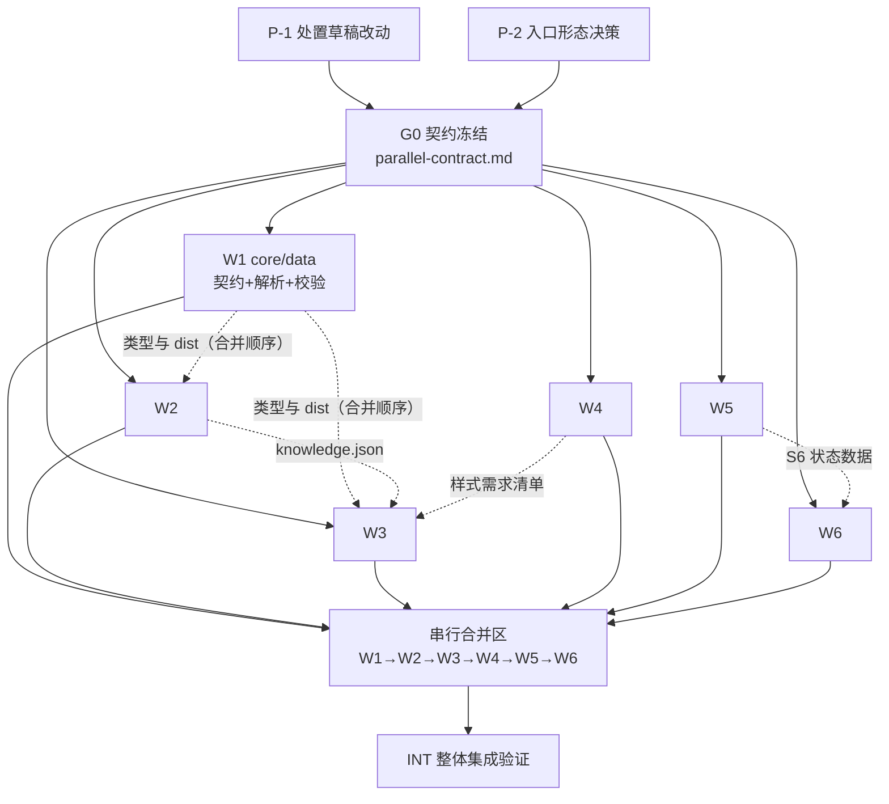

# 14 · 并行任务窗口计划（基于《13 · 检查复盘与后续改进方案》）

| 项 | 内容 |
| --- | --- |
| 文档性质 | 任务编排 / 并行执行计划 |
| 上位文档 | `项目规划/13-阶段前检查复盘与后续改进方案.md`（下称「13 号方案」） |
| 编制日期 | 2026-11-18 |
| 状态 | 待评审 · 窗口未启动 |
| 适用 | 多个独立任务窗口同时开工的场景；单窗口串行执行时按 §5 合并顺序依次做即可 |

> **本计划的核心不是"分几组人"，而是"分文件"。** 只要每个文件只有一个窗口能写，
> 六个窗口就可以真正并行，且不产生文件/模块/职责冲突。§3 的所有权矩阵是全文最硬的一节。

---

## 0. 开工前必须先决的两件事（2026-11-18 已决）

| 编号 | 前置事项 | 结论 | 决断人与日期 | 落地要求 |
| --- | --- | --- | --- | --- |
| P-1 | 13 号方案附录 C 的未提交改动如何处置 | **保留** | 用户 · 2026-11-18 | 各窗口第一件事是核对本范围草稿是否已存在，存在则纳入版本管理并按验收标准补验证，**不重复重写、不覆盖**；G0 打基线 tag 前先完成这一步 |
| P-2 | 「知识」入口形态 A／B | **先按 A：题库页内精读区，不动路由** | 用户 · 2026-11-18 | `router.ts` / `App.tsx` / `ui/AppShell.tsx` **全线冻结**；讲义入口由 W3 在 `BanksPage` 内实现 |

> P-2 后续若改选 B，必须由 G0 发「契约变更单」，把三个路由/外壳文件整体划归 W4、
> W3 改为交付不带路由的纯组件，并广播全部窗口。变更前的 A 方案结论仍是当前唯一有效口径。
> 每个窗口的权威定义见 `项目规划/任务窗口/*.md`（§4 索引）。

---

## 1. 总体编排

### 1.1 窗口总览

| 窗口 | 名称 | 对应 13 号方案 | 可独立启动 | 主要独占目录 |
| --- | --- | --- | --- | --- |
| **G0** | 契约与决策冻结（串行前置门禁） | §8 变更登记、P-1/P-2 | 否，必须先做 | `web-v2/docs/plans/`（新建） |
| **W1** | 核心契约与校验 | I-4、I-2 解析部分 | ✅ 是 | `packages/core/**`、`packages/data/**` |
| **W2** | 讲义内容生产 | I-1 内容部分 | ✅ 是 | `packages/content/**` |
| **W3** | 讲义阅读与视频界面 | I-1 界面、I-2 播放 | ✅ 是（typecheck 需 W1 产物） | `apps/web/src/features/knowledge/**`、`BanksPage.tsx`、`styles.css` |
| **W4** | 既有页面一致性 | I-5 | ✅ 是 | `features/practice/**`、`features/me/**`、`app.test.tsx` |
| **W5** | S6 上线收尾 | I-3 | ✅ 是 | `apps/web/src/cloud/**`、`docs/cloud/**`、`.github/**`、`public/**`、`项目规划/07` |
| **W6** | 文档、ADR 与集成登记 | §8、§9、附录 A | ✅ 是（收尾串行） | `项目规划/00、08、13、14`、`README.md`、`docs/adr/**`、所有 `package.json` |
| **INT** | 整体集成验证（串行收口） | §6 验收总表 | 否，必须最后 | 集成分支，不新增功能 |

**本轮不启动**：I-6（讲义第二轮）、I-7～I-11（编辑器 / 记忆卡 / 计划 / FSRS / 弱项推荐 / AI），
按 13 号方案 §4 的"启动证据"门槛另开批次，不塞进本轮，避免范围膨胀（R-A）。

### 1.2 依赖图



> 实线 = 必须串行；虚线 = **开发期不阻塞**（按 G0 契约文本各写各的），只在合并/构建期兑现。
> 这是"可并行"成立的关键：**用冻结的契约文本代替互相等待对方的代码**。

---

## 2. G0 · 串行前置门禁（必须先完成，约 0.5 个工作块）

| 项 | 内容 |
| --- | --- |
| **目标** | 把"接口长什么样、谁改哪个文件、决策是什么"写成一份不可随意改的冻结文本，让六个窗口能同时开工 |
| **负责范围** | 只新建 `web-v2/docs/plans/parallel-contract.md` 与 `web-v2/docs/plans/window-board.md`；**不改任何代码与既有文档** |
| **输入依赖** | 13 号方案、本计划、**已决的 P-1（保留草稿）/ P-2（先按 A）**；权威细节见 `任务窗口/G0-契约冻结门禁.md` |
| **执行步骤** | 1) `git status` 核对 P-1 保留草稿齐备并提交成基线快照（当前 `general-dev`）；2) 创建 `integrate/s7-e8`；3) 写契约文本与看板（含已决结论、§3 所有权矩阵、分支清单）；4) **提交冻结件**到 `integrate`；5) 从含契约的 HEAD 打 tag `s7e8-contract-frozen` 并创建六个窗口分支；6) 广播。顺序不可颠倒，否则分支读不到契约 |
| **产出物** | `parallel-contract.md`（冻结件）、`window-board.md`（状态看板）、基线 tag、六个窗口分支、`w0-freeze-report.md` |
| **验收标准** | ① 契约文本包含全部 TS 类型签名、`parseMediaSource` 输入输出样例（含非法协议）、导入错误码格式；② 每个窗口分支名唯一且已从同一基线创建；③ 已决结论与草稿核对结果写入文本；④ 所有权矩阵与本文 §3 逐行一致 |
| **衔接方式** | 各窗口**只读**该契约；**真并行必须用 `git worktree` 给每个窗口独立目录**（见 `G0` 分文件 §4 步骤 9），否则多窗口共用 `F:/001/刷题` 时 `git checkout` 会互相覆盖；任何字段/签名变更必须发起「契约变更单」→ G0 更新文本 → 广播全部窗口 |

---

## 3. 文件所有权矩阵（防冲突核心，逐行硬约束）

| 路径 / 模式 | 独占窗口 | 其它窗口允许做的事 |
| --- | --- | --- |
| `packages/core/src/**`（含 `schema.ts` `validate.ts` `index.ts` `media.ts` 及测试） | **W1** | 只读 import |
| `packages/data/src/**` | **W1** | 只读 import |
| `packages/content/**`（含 `lectures/**`、`knowledge.json`、生成脚本、content 单测） | **W2** | 只读引用 |
| `apps/web/src/features/knowledge/**` | **W3** | 只读 |
| `apps/web/src/features/banks/BanksPage.tsx` | **W3** | 只读 |
| `apps/web/src/styles.css` | **W3** | W4 只提「样式需求清单」，由 W3 落地 |
| `apps/web/src/features/practice/**`、`features/me/ImportExport.tsx` | **W4** | 只读 |
| `apps/web/src/app.test.tsx` 及 features 下既有测试 | **W4** | W3 的新测试写在 `features/knowledge/**` 内，不碰 `app.test.tsx` |
| `apps/web/src/router.ts`、`App.tsx`、`ui/AppShell.tsx` | **冻结**（P-2 已决 A）；后续改选 B 须走契约变更单并整体划归 W4 | 当前口径下任何窗口不得改 |
| `apps/web/src/cloud/**`、`docs/cloud/**`、`.github/workflows/**`、`apps/web/public/**` | **W5** | 只读 |
| `项目规划/07-S6-云同步PWA与发布切换.md` | **W5** | 其它窗口不改 |
| `项目规划/00`、`08`、`13`、`14`、`README.md`、`T0-7-文件职责表.md` | **W6** | W5 交「状态数据」由 W6 回填 |
| `web-v2/docs/adr/**` | **W6** | 只读 |
| `web-v2/docs/reports/**` | 各窗口**只能新建自己的报告文件**（前缀 `w1-` / `w2-` …） | 禁止改已有报告及他人报告 |
| 所有 `package.json`、`pnpm-lock.yaml` | **W6** | W2 只提供脚本文件，不自行登记 npm script |
| `*/dist/**`、`build/.pyi/**`、`apps/web/deploy-site/**` | **不提交**；集成窗口统一重建 | 各窗口本地构建可读，禁止提交产物 |
| 根目录旧版（`_build/**`、`*.html`、`题库网页/**`） | **冻结** | 任何窗口不得改（README §2 硬规则） |

**三条通用纪律**

1. **新增文件优先**：能新建就不改既有文件，减少同行冲突。
2. **禁止跨窗口提交**：一个 commit 只属于一个窗口，提交信息带窗口前缀（如 `feat(s7e8-w3): …`）。
3. **契约变更单**：G0 冻结后改接口，必须先改契约文本并广播，不允许"我这边先改了再说"。

---

## 4. 六个并行窗口卡片（摘要；权威定义见分文件）

**每个窗口已单独整理成一份自包含文件**，含目标、范围、输入依赖、执行步骤、产出物、
验收标准、衔接方式、特有风险、可复制启动提示词与完成回执。分文件是本节的权威定义；
下方卡片只作快速对照，**若两者不一致，以分文件为准**。

| 窗口 | 分文件（`项目规划/任务窗口/` 下） | 分支 | 一句话定位 |
| --- | --- | --- | --- |
| G0 | `G0-契约冻结门禁.md` | `integrate/s7-e8` | 串行前置：冻结契约与决策 |
| W1 | `W1-核心契约与校验.md` | `feat/s7e8-core-contract` | 契约、URL 解析、导入校验 |
| W2 | `W2-讲义内容生产.md` | `content/s7e8-lectures` | 7 篇讲义源与生成脚本 |
| W3 | `W3-讲义阅读与视频界面.md` | `feat/s7e8-lecture-ui` | 精读界面与视频播放 |
| W4 | `W4-既有页面一致性.md` | `fix/s7e8-ui-consistency` | 清占位、补回归用例 |
| W5 | `W5-S6上线收尾.md` | `chore/s6-closeout` | 真实迁移、回退演练、双 CI |
| W6 | `W6-文档ADR与集成登记.md` | `docs/s7e8-integration` | ADR、变更登记、changelog |
| INT | `INT-整体集成验证.md` | `integrate/s7-e8` | 唯一最终判定与证据表 |

> 已决前提（写入全部分文件）：**P-1 = 保留草稿**、**P-2 = 先按 A（路由冻结）**。

### W1 · 核心契约与校验窗口

| 项 | 内容 |
| --- | --- |
| **目标** | 让讲义新字段、视频 URL 解析、导入校验三件事在 `core/data` 落地并可被 Node 单测证明 |
| **负责范围（白名单）** | `packages/core/src/**`、`packages/data/src/**`；对应 13 号方案 I-4 与 I-2 的解析部分 |
| **明确不碰（黑名单）** | content、apps/web、cloud、项目规划文档、任何 `package.json` |
| **输入依赖** | ① G0 冻结契约文本（必需）；② 现有 `docs/adr/0001~0006`、`validate.ts`、`snapshot.ts`（只读）；③ 不依赖其它窗口产出 |
| **执行步骤** | 1) 按契约扩展 `KnowledgeModule`（6 个可选字段，`items` 放宽为缺省空数组）；2) 新增 `KnowledgeSection/Video/Resource` Schema 并在 `index.ts` 导出；3) 写 `media.ts` 纯函数解析器（B 站/YouTube/直链/HLS/网页/非法），**不使用 DOM `URL`**（core 不引 DOM 类型）；4) 写 `validateKnowledgeModules`，含"items 与 sections 不得同时为空"的语义检查并定位到 `knowledge[i]`；5) 在 `parseBankJson` 接入讲义校验；6) 补单测：契约向后兼容、非法协议、导入失败不写入 |
| **产出物** | 契约与解析器源码、`media.test.ts` / `knowledge.test.ts` / snapshot 导入用例、`docs/reports/w1-contract-test.md` |
| **验收标准** | C-1～C-5 全过；B-1/B-2 全过；`pnpm --filter @quiz/core test` 与 `--filter @quiz/data test` 全绿；`check:boundaries` 通过（core 仍无 DOM/React 依赖）；旧题库包（含 chemistry）导入不回退 |
| **衔接方式** | **向下游提供**：冻结的类型定义与 `parseMediaSource` 行为表（已在 G0 文本中，实现须逐条对齐）、`validateKnowledgeModules` 导出。**最先合并**，合并后立即 `pnpm -r build` 产出 dist 供 W2/W3 typecheck。**不接收**任何其它窗口的代码依赖 |

### W2 · 讲义内容生产窗口

| 项 | 内容 |
| --- | --- |
| **目标** | 把 7 篇讲义写成可精读的 Markdown 源，并生成合规的 `knowledge.json` |
| **负责范围（白名单）** | `packages/content/javaweb-final/lectures/**`、`javaweb-final/knowledge.json`、`packages/content/scripts/build-knowledge.mjs`、`packages/content/src/knowledge.test.ts` |
| **明确不碰** | `packages/core/**`、`packages/data/**`、`apps/web/**`、任何 `package.json`（脚本登记由 W6 做） |
| **输入依赖** | ① G0 契约文本（字段与视频地址规范）；② 13 号方案 §5 I-1 的内容规范与 A-1～A-3；③ `JavaWeb期末全题型题库.md`（内容事实核对，只读）；④ 公开课程 BV 号线索（附录 B，需人工确认可播） |
| **执行步骤** | 1) 定 `lectures/NN-*.md` 的 front matter 格式与正文八段模板；2) 逐篇写 7 篇（学习目标/速览/正文分节/代码/对比表/考试怎么考/自测）；3) 写生成脚本：解析 front matter → 按 `##` 切节 → 输出 JSON，**脚本内自带格式校验，不 import `@quiz/core`**（避免等 W1 的 dist）；4) 写内容质量门禁单测（篇幅/节数/代码块/表格/目标/视频/标题唯一）；5) 生成 `knowledge.json` 并人工抽检 2 篇 |
| **产出物** | 7 篇 Markdown 源 + `lectures/README.md`、生成脚本、`knowledge.json`、质量门禁单测、`docs/reports/w2-content-check.md`（含字数/节数统计） |
| **验收标准** | A-1～A-3、B-6 全过；每篇 ≥8 节、≥3000 字、含代码块与表格、≥3 目标、≥2 易错点；总正文 ≥50k 字；生成脚本重跑两次产物字节一致；所有视频地址能被 W1 的解析器识别（集成时联验） |
| **衔接方式** | **向下游提供**：`knowledge.json`（W3 装配）、内容规范样例（W6 写 README 用）。**从 W1 接收**：仅集成期用 `validateKnowledgeModules` 复验一次，开发期不等待。**注意**：若 P-1 选"保留草稿"，本窗口第一件事是把草稿内容纳入版本管理并核对，而不是重写 |

### W3 · 讲义阅读与视频界面窗口

| 项 | 内容 |
| --- | --- |
| **目标** | 做出"选一篇 → 精读 → 看视频 → 去练本节"的完整阅读体验，且断网不崩 |
| **负责范围（白名单）** | `apps/web/src/features/knowledge/**`（组件 + 组件级测试）、`features/banks/BanksPage.tsx`、`apps/web/src/styles.css` |
| **明确不碰** | `router.ts` / `App.tsx` / `AppShell.tsx`（决策 A 下冻结）、`PracticePage.tsx`、`app.test.tsx`、`cloud/**`、所有 `package.json` |
| **输入依赖** | ① G0 契约文本（类型签名 + `parseMediaSource` 行为表 + P-2 决策）；② `RichText` 既有渲染管线（只读）；③ W1 的 core 类型（合并期兑现）；④ W2 的 `knowledge.json`（合并期兑现）；⑤ W4 的「样式需求清单」（若有） |
| **执行步骤** | 1) 写纯组件：模块目录、单篇正文（目标/目录/锚点/小节/视频/易错点/拓展/练本节）；2) 写视频卡：原生 `<video>` 管直链、站外 iframe **点击后才加载**、非法地址提示卡、HLS 差异提示；3) 接 `BanksPage` 讲义区；4) 写「去练本节」：只更新练习设置的 `topicIds`，其余设置不动；5) 补组件级测试（不碰 `app.test.tsx`）；6) 样式落地（含移动端） |
| **产出物** | 组件源码与测试、样式、`docs/reports/w3-ui-smoke.md`（含断网手测记录） |
| **验收标准** | A-4～A-7、B-3～B-5、B-7 全过；未点击前零第三方请求（网络面板证据）；断网文字讲义完整可读且无控制台异常；`check:extension` 通过；`pnpm --filter @quiz/web typecheck` 通过（需 W1 dist） |
| **衔接方式** | **从 W1 拿**：类型与解析器；**从 W2 拿**：讲义数据；**给 W4**：若需改 `styles.css` 之外无交集，W4 提需求清单由本窗口落地。**后续若改选 B（须走契约变更单）**：本窗口只交付纯组件，路由接线整体交给 W4，本窗口不改 `router.ts` |

### W4 · 既有页面一致性窗口

| 项 | 内容 |
| --- | --- |
| **目标** | 清掉"待 S4/S5"占位，让界面宣称的能力与实际一致，并补回归用例 |
| **负责范围（白名单）** | `apps/web/src/features/practice/PracticePage.tsx`、`features/me/ImportExport.tsx`、`apps/web/src/app.test.tsx` 及 features 下既有测试；**P-2 已决 A，路由三文件不在本窗口范围**（后续改选 B 并经契约变更单后才加入） |
| **明确不碰** | `features/knowledge/**`、`BanksPage.tsx`、`styles.css`（改样式需提清单给 W3）、`cloud/**`、`项目规划/**` |
| **输入依赖** | ① G0 决策（P-2）；② `docs/reports/s5-feature-parity.md`（只读）；③ 不依赖 W1/W2/W3 的代码（可立即启动） |
| **执行步骤** | 1) 全文搜"待 S4/S5/S6"占位并逐个处置（改为真实入口或明确说明）；2) 「只刷未掌握」接 S4 状态机；3) 导入导出预览的讲义信息展示核对（篇数/节数）；4) 补 `app.test.tsx` 回归：六入口、筛选、游客闭环不回退；5) 当前 A 方案不做此项；仅当后续改选 B 并经契约变更单后才接独立「知识」Tab 与导航项 |
| **产出物** | 页面改动、回归用例、`docs/reports/w4-parity-regression.md`、给 W3 的「样式需求清单」（如有） |
| **验收标准** | 全局搜索无"待 S4/S5/S6"字样；`app.test.tsx` 既有用例全绿且新增用例通过；六入口均可进入且有实质内容；与 W3 合并后无路由/样式冲突 |
| **衔接方式** | **给 W3**：样式需求清单（不直接改 CSS）；**给 W6**：一致性结论（用于 changelog）。与 W3 的唯一潜在交集是 `styles.css` 与（选 B 时）路由文件，已按矩阵切开 |

### W5 · S6 上线收尾窗口

| 项 | 内容 |
| --- | --- |
| **目标** | 让 SC-5 成立：真实迁移、真实同步、回退演练、双 CI 绿 |
| **负责范围（白名单）** | `apps/web/src/cloud/**`、`web-v2/docs/cloud/**`、`.github/workflows/**`、`apps/web/public/**`（PWA）、`项目规划/07-S6-云同步PWA与发布切换.md`；新建 `docs/reports/w5-s6-closeout.md` |
| **明确不碰** | `项目规划/00`（状态表由 W6 回填）、`README.md`、其它窗口的报告、core/content/web 业务源码 |
| **输入依赖** | ① `07-S6` §5 runbook；② 云凭据、至少 2 个测试账号（RLS 交叉验证）；③ 旧云表只读备份；④ 合法 Origin/回调域名；⑤ 不依赖其它窗口产出 |
| **执行步骤** | 1) 备份与检查点 → 2) 短暂停写 → 3) 增量迁移（真实旧数据迁到新 uid）→ 4) 分用户/表对账 → 5) 真实同步与跨设备验证 → 6) 回退步骤演练并留证 → 7) `legacy-ci` 与 `general-ci` 双绿 → 8) Release 记录 |
| **产出物** | 迁移对账表、同步验证记录、回退演练记录、CI 记录、`w5-s6-closeout.md`、给 W6 的「S6 状态数据」 |
| **验收标准** | G6-1～G6-7 逐条留证；对账差异 0；游客数据登录后合并不覆盖；断网可打开并刷已缓存题库；回退演练可停可退；双 CI 绿；`pnpm verify` 在干净环境全绿（含构建期清空目录问题的处置记录） |
| **衔接方式** | **给 W6**：S6 状态数据（日期、标签、遗留问题数）用于回填 `00` §8。**与其它窗口零文件交集**，可在任意顺序合并；但建议早合以便尽早跑 CI |

### W6 · 文档、ADR 与集成登记窗口

| 项 | 内容 |
| --- | --- |
| **目标** | 把契约变更、决策、职责表、状态与 changelog 全部留痕，避免"代码改了文档没跟" |
| **负责范围（白名单）** | `项目规划/00`、`08`、`13`、`14`、`README.md`、`T0-7-文件职责表.md`、`web-v2/docs/adr/**`、**所有** `package.json` 与 `pnpm-lock.yaml`、`web-v2/CHANGELOG.md`（新建） |
| **明确不碰** | 任何源码、`docs/reports/**` 已有报告、`项目规划/07`（属 W5） |
| **输入依赖** | ① G0 契约文本；② W1 的字段清单（写 ADR）；③ W2 的脚本路径（登记 `knowledge:build`）；④ W5 的 S6 状态数据；⑤ 各窗口报告路径（写 changelog） |
| **执行步骤** | 1) 起草新 ADR（`0007-knowledge-lecture-schema.md`：向后兼容口径、`schemaVersion` 是否升版及理由）；2) 在 `00` §9 补变更登记行；3) 在 `08` §7 登记 S7-E8 事项；4) 更新 `README.md` §2 与 `T0-7` 文件职责表（新增 `lectures/`、`knowledge.json` 为生成物）；5) 统一登记 npm script（W2 只交脚本文件）；6) **最后**回填 `00` §8 状态表、打阶段标签、写 changelog |
| **产出物** | 新 ADR、变更登记、职责表、README 更新、npm script 登记、CHANGELOG、阶段标签 |
| **验收标准** | 13 号方案 §8 四项变更全部有登记；ADR 明确"字段全可选 + 旧数据零迁移"；`README` 能据文重建 `knowledge.json`；changelog 覆盖全部窗口且无"以后补"；`00` §8 与 W5 报告一致 |
| **衔接方式** | **可并行启动**（起草模板与 ADR），**必须串行收尾**（回填状态、changelog 依赖 W1/W2/W3/W4/W5 全部完成）。是合并顺序中的最后一环 |

### 可直接复制的窗口启动提示词

> 每个窗口都是自包含的，复制到独立任务窗口即可启动。路径均为 `F:/001/刷题` 下的相对路径。

**W1**
```
你在 F:/001/刷题 工作。任务：S7-E8 核心契约与校验窗口。
先完整阅读 web-v2/docs/plans/parallel-contract.md（冻结契约）与 项目规划/14-并行任务窗口计划.md §4 W1。
只允许修改 web-v2/packages/core/src/** 与 web-v2/packages/data/src/**；禁止改 content、apps/web、cloud、项目规划文档、任何 package.json。
实现讲义契约扩展（6 个可选字段，items 缺省空数组）、validateKnowledgeModules（items 与 sections 不得同时为空，错误定位 knowledge[i]）、parseMediaSource 纯函数（B站/YouTube/直链/HLS/网页/非法协议，不得使用 DOM 的 URL）、parseBankJson 接入讲义校验，并补齐单测。
验收：C-1~C-5、B-1/B-2 全过；pnpm --filter @quiz/core test 与 --filter @quiz/data test 全绿；check:boundaries 通过。
产出报告写 web-v2/docs/reports/w1-contract-test.md。提交信息前缀 feat(s7e8-w1)。完成后报告改了哪些文件与实测命令输出。
```

**W2**
```
你在 F:/001/刷题 工作。任务：S7-E8 讲义内容生产窗口。
先阅读 web-v2/docs/plans/parallel-contract.md、项目规划/13-阶段前检查复盘与后续改进方案.md §5 I-1、项目规划/14 §4 W2。
只允许修改 web-v2/packages/content/javaweb-final/lectures/**、javaweb-final/knowledge.json、packages/content/scripts/build-knowledge.mjs、packages/content/src/knowledge.test.ts；禁止改 core、data、apps/web、任何 package.json。
写 7 篇讲义 Markdown（固定八段结构）+ 生成脚本（脚本自带格式校验，不 import @quiz/core）+ 内容质量门禁单测，生成 knowledge.json。
验收：A-1~A-3、B-6 全过；每篇 ≥8 节/≥3000 字/含代码块与表格/≥3 目标/≥2 易错点；总正文 ≥50k 字；脚本重跑两次产物字节一致。
产出报告写 web-v2/docs/reports/w2-content-check.md。提交信息前缀 content(s7e8-w2)。完成后报告篇数、节数、字数统计。
```

**W3**
```
你在 F:/001/刷题 工作。任务：S7-E8 讲义阅读与视频界面窗口。
先阅读 web-v2/docs/plans/parallel-contract.md、项目规划/13 §5 I-1/I-2、项目规划/14 §4 W3（含 P-2 决策）。
只允许修改 web-v2/apps/web/src/features/knowledge/**、features/banks/BanksPage.tsx、apps/web/src/styles.css；禁止改 router.ts/App.tsx/AppShell.tsx（决策 A）、PracticePage.tsx、app.test.tsx、cloud/**。
实现模块目录 + 单篇精读（目标/目录锚点/分节正文/视频/易错点/拓展/去练本节）+ 视频卡（直链用原生 video，站外 iframe 点击后才加载，非法地址给提示卡，HLS 给差异提示）+ 接 BanksPage + 组件级测试 + 样式。
验收：A-4~A-7、B-3~B-5、B-7 全过；未点击前零第三方请求；断网文字讲义完整可读；check:extension 与 web typecheck 通过。
产出报告写 web-v2/docs/reports/w3-ui-smoke.md。提交信息前缀 feat(s7e8-w3)。完成后报告改动文件与断网手测结果。
```

**W4**
```
你在 F:/001/刷题 工作。任务：S7-E8 既有页面一致性窗口。
先阅读 web-v2/docs/plans/parallel-contract.md（含 P-2 决策）、项目规划/14 §4 W4、web-v2/docs/reports/s5-feature-parity.md。
只允许修改 web-v2/apps/web/src/features/practice/**、features/me/ImportExport.tsx、apps/web/src/app.test.tsx 及 features 下既有测试；若 P-2 选 B 再加 router.ts/App.tsx/ui/AppShell.tsx。禁止改 features/knowledge/**、BanksPage.tsx、styles.css、cloud/**、项目规划/**。
清除"待 S4/S5/S6"占位并接真实能力，补回归用例；如需样式改动，只产出「样式需求清单」交给 W3，不直接改 CSS。
验收：全局无"待 S4/S5/S6"字样；app.test.tsx 既有用例全绿；六入口均有实质内容。
产出报告写 web-v2/docs/reports/w4-parity-regression.md。提交信息前缀 fix(s7e8-w4)。完成后报告回归用例数与结论。
```

**W5**
```
你在 F:/001/刷题 工作。任务：S6 上线收尾窗口（唯一会碰真实用户数据的窗口）。
先阅读 项目规划/07-S6-云同步PWA与发布切换.md 全文与 项目规划/14 §4 W5。
只允许修改 web-v2/apps/web/src/cloud/**、web-v2/docs/cloud/**、.github/workflows/**、apps/web/public/**、项目规划/07-S6-云同步PWA与发布切换.md，并新建 web-v2/docs/reports/w5-s6-closeout.md；禁止改 项目规划/00、README、其它报告、业务源码。
按 07 §5 runbook 执行：备份与检查点 → 短暂停写 → 增量迁移（真实旧数据到新 uid）→ 分用户/表对账 → 真实同步与跨设备验证 → 回退演练 → 双 CI 绿 → Release 记录。
硬要求：动手前先备份；任何一步失败可停可退；不清理旧云表；G6-1~G6-7 逐条留证。
产出「S6 状态数据」交给 W6 回填 00 §8。提交信息前缀 chore(s6-closeout)。
```

**W6**
```
你在 F:/001/刷题 工作。任务：S7-E8 文档、ADR 与集成登记窗口。
先阅读 web-v2/docs/plans/parallel-contract.md、项目规划/13 §8/§9、项目规划/14 §3 与 §4 W6。
只允许修改 项目规划/00、08、13、14、README.md、T0-7-文件职责表.md、web-v2/docs/adr/**、所有 package.json 与 pnpm-lock.yaml、新建 web-v2/CHANGELOG.md；禁止改任何源码、已有报告、项目规划/07。
起草 ADR 0007（向后兼容口径与 schemaVersion 决策）、补 00 §9 变更登记、08 §7 登记 S7-E8、更新 README §2 与职责表、统一登记 knowledge:build 脚本。
注意：本窗口可并行起草，但回填 00 §8 状态表、打标签、写 changelog 必须等 W1~W5 全部完成。
验收：13 §8 四项变更全部登记；README 能据文重建 knowledge.json；changelog 无"以后补"；00 §8 与 W5 报告一致。
提交信息前缀 docs(s7e8-w6)。
```

---

## 5. 必须串行处理的前置依赖与合并顺序

| 顺序 | 环节 | 为什么必须串行 | 门禁 |
| --- | --- | --- | --- |
| 0 | P-1 / P-2 决断（**已决**：保留草稿 / 先按 A） | 决定基线与文件边界 | 结论已写入 §0、13 号附录 C 与全部分文件；G0 只需核对同步 |
| 1 | **G0 契约冻结**（先提交冻结件，再从含契约的 HEAD 开窗口分支） | 六个窗口靠同一份文本并行，文本没提交就开分支，六个分支都读不到契约，全部要 rebase | §2 四项验收 + 分支均出自 `s7e8-contract-frozen` |
| 2 | **W1 先合并 → `pnpm -r build`** | core/data 的 dist 是 W2 生成脚本联验与 W3 typecheck 的前提；且 `core/src/index.ts` 被 W1 独占，避免多窗口争抢 | W1 验收全过 + dist 产出 |
| 3 | W2 合并（rebase 到 2） | 用 W1 的 `validateKnowledgeModules` 复验 `knowledge.json` | A-1～A-3、B-6 复验通过 |
| 4 | W3 合并（rebase 到 3） | 需要 W1 类型 + W2 数据才能真正 typecheck | W3 验收全过 |
| 5 | W4 合并 | 与 W3 的样式/路由边界在集成处验一次 | 回归用例全绿 |
| 6 | W5 合并（可提前，建议早合跑 CI） | 云迁移涉及真实数据，必须在**其它窗口不再改数据结构**之后执行最终对账 | G6-1～G6-7 |
| 7 | **W6 收尾回填** | 状态表/changelog 依赖全部窗口结果 | §4 W6 验收 |
| 8 | **INT 整体集成验证** | 只有全量合并后才能做端到端判定 | §6 |

**允许真正并行开发的是 W1～W6 的编码/写作阶段**；合并、对账、发布验证、文档回填一律串行。
特别注意：**W5 的正式迁移与 W1 的契约变更不能同时"生效"**——契约未冻结前不迁数据，避免云端数据结构与本地契约不一致。

---

## 6. 整体集成验证方式（INT）

### 6.1 执行步骤（在干净环境、集成分支 `integrate/s7-e8` 上）

> 权威定义与证据表模板见 `任务窗口/INT-整体集成验证.md`；本节为总览摘要。
> 已决前提：P-1 = 保留草稿（故第 1 步判据是"草稿已纳入版本管理"，不是"草稿不存在"）、P-2 = A（路由无改动）。

| 步 | 命令 / 动作 | 通过判据 |
| --- | --- | --- |
| 1 | 确认 P-1 处置完成、工作区无草稿残留 | `git status` 干净（或草稿已纳入版本管理） |
| 2 | `node web-v2/packages/content/scripts/build-knowledge.mjs` | 输出 7 篇 / ≥50k 字；与 W2 提交的 `knowledge.json` 字节一致 |
| 3 | `cd web-v2 && pnpm -r build` | 全部包构建成功，无 TS 错误 |
| 4 | `pnpm verify` | 边界扫描 + 扩展点扫描 + 构建 + 空位对账 + 功能对等 + 全量单测全绿 |
| 5 | `python3 _build/ci_check.py`（根目录） | 旧版 15 项结构自检全绿，两份 HTML 字节一致（旧版未受影响） |
| 6 | `pnpm --filter @quiz/core exec vitest run` 复核契约用例 | C-1～C-5、B-1/B-2 全过 |
| 7 | 产物拷到空目录启动，做浏览器实操 | 见 6.2 冒烟清单 |
| 8 | 云同步 / 回退 / 双 CI 复核 | 与 W5 的 `w5-s6-closeout.md` 一致 |
| 9 | 汇总证据表 → W6 回填 `00` §8 与 changelog | 证据表无空缺项 |

> 第 4 步若复现 13 号方案 D-06（构建期清空 `dist/` 被安全策略拦截），
> 处置方式是**先把产物目录改名再构建**（`dist` → `dist.prev`），**禁止删除源码或清空 `build/`**；
> 处置命令与结果写入证据表。

### 6.2 冒烟清单（HTTP 层 + 人工三项）

| 类型 | 项 | 判据 |
| --- | --- | --- |
| 自动 | 首页、静态资源、健康检查 | 200 且字节数与源文件一致 |
| 自动 | 全部单测与构建 | 退出码 0 |
| 人工 | **断网复跑** | 文字讲义完整可读；视频区给"需联网"提示；零外网请求；无控制台异常 |
| 人工 | **讲义→练习联动** | 选第 5 篇 → 点「去练本节」→ 知识点筛选生效、其它设置不变 → 作答 → 记录落库 |
| 人工 | **数据持久化** | 新增 → 修改 → 刷新 → 关闭重开，记录仍在且无重复 |
| 人工 | 导入导出往返 | 导出题库包 → 再导入，讲义篇数/节数/题数不变 |
| 人工 | 空 / 错 / 权限 | 新用户零记录、断网、未登录游客路径均可走通 |

### 6.3 证据表模板（由 INT 负责人填写，交 W6）

| 编号 | 命令 / 场景 | 预期 | 实测 | 结论 | 执行人 |
| --- | --- | --- | --- | --- | --- |
| E-01 | `pnpm verify` | 全绿 | | | |
| E-02 | 讲义生成幂等 | 字节一致 | | | |
| E-03 | 断网复跑 | 零外网请求 | | | |
| … | | | | | |

---

## 7. 潜在风险与缓解

| 编号 | 风险 | 触发信号 | 缓解措施 | 责任窗口 |
| --- | --- | --- | --- | --- |
| K-01 | **契约漂移**：某窗口私下改字段/签名 | 合并时类型对不上 | G0 冻结文本 + 契约变更单 + 广播；禁止窗口间私下约定 | G0 / 全体 |
| K-02 | **保留草稿的基线不一致**（P-1 = 保留） | 各窗口基于不同草稿基线，或基线 tag 漏掉部分草稿 | G0 先 `git status` 核对保留草稿齐备再打 tag；各窗口第一件事是纳入版本管理而非重写 | G0 / 全体 |
| K-03 | **共享文件冲突**：`styles.css`、`package.json`、`项目规划/00`、报告目录 | 合并冲突 | §3 所有权矩阵；W4 提样式清单、W2 不登记 script、W5 交状态数据、报告只许新建 | 全体 |
| K-04 | **dist 构建产物被提交** | 仓库出现 `*/dist/**` 变更 | 矩阵明确"不提交"，集成窗口统一重建；`.gitignore` 核对 | INT / W6 |
| K-05 | **core 引入 DOM 依赖**（`URL` 等） | core 在 Node 下单测失败 | W1 用正则实现解析，`check:boundaries` 兜底 | W1 |
| K-06 | **云数据不可逆** | 迁移中途失败 | 备份 → 检查点 → 短暂停写 → 分步对账 → 可停可退；契约未冻结前不迁数据 | W5 |
| K-07 | **视频外链失效 / 断网白屏** | 链接 404、离线打开黑框 | 文字讲义自足、点击才加载、失效降级为跳转卡、季度巡检清单 | W2 / W3 |
| K-08 | **视频 URL 注入** | 导入包含 `javascript:` 地址 | core 协议白名单 + 导入即校验 + UI 不拼裸 `src` | W1 / W3 |
| K-09 | **讲义体积拖慢首屏** | JS bundle 明显增大 | 集成时测量增量；阈值建议 ≤150 KB（gzip 前），超出则改按需加载 | INT / W3 |
| K-10 | **旧版被误改** | 根目录 HTML 出现 diff | README §2 硬规则 + 矩阵冻结旧版 + `ci_check.py` 两份 HTML 一致性 | 全体 |
| K-11 | **窗口各自宣称"通过"但整体不通过** | 单窗口绿、集成红 | 只有 INT 的证据表算最终判定；单窗口报告只作过程留痕 | INT |
| K-12 | **范围膨胀**：P1/P2 事项被顺手做进来 | 提交里出现编辑器/FSRS | 本轮明确不启动 I-6～I-11；每项独立分支、可单独 revert | G0 / W6 |

---

## 附录 A · G0 契约冻结文本的最小内容

1. **P-1 / P-2 结论**（含日期与决策人）。
2. **TS 类型签名**：`KnowledgeModule`（6 个新增可选字段 + `items` 缺省 `[]`）、`KnowledgeSection`、`KnowledgeVideo`、`KnowledgeResource`、`validateKnowledgeModules` 签名与错误路径格式、`parseMediaSource` 签名与 `MediaSource` 全部字段。
3. **`parseMediaSource` 行为表**：B 站完整链接 / 裸 BV 号 / av 号 / YouTube 三种写法 / mp4 直链 / 相对路径 / m3u8 / 普通网页 / `b23.tv` 短链 / `javascript:` / 空串，逐行给出期望 `kind` 与 `watchUrl`。
4. **导入错误码格式**：`[SCHEMA_INVALID] knowledge[i].字段: 说明`。
5. **Markdown 讲义 front matter 字段表**与 `##` 切节规则。
6. **§3 所有权矩阵 + 六个窗口分支名 + 合并顺序**（与本文一致）。
7. **契约变更单流程**：发起人 → G0 更新文本 → 广播 → 各窗口确认。

## 附录 B · 窗口状态看板模板（`window-board.md`）

| 窗口 | 分支 | 启动 | 开发中 | 自验通过 | 已合并 | 报告路径 | 备注 |
| --- | --- | --- | --- | --- | --- | --- | --- |
| W1 | `feat/s7e8-core-contract` | | | | | `reports/w1-contract-test.md` | 最先合并 |
| W2 | `content/s7e8-lectures` | | | | | `reports/w2-content-check.md` | |
| W3 | `feat/s7e8-lecture-ui` | | | | | `reports/w3-ui-smoke.md` | |
| W4 | `fix/s7e8-ui-consistency` | | | | | `reports/w4-parity-regression.md` | |
| W5 | `chore/s6-closeout` | | | | | `reports/w5-s6-closeout.md` | 碰真实数据 |
| W6 | `docs/s7e8-integration` | | | | | `web-v2/CHANGELOG.md` | 最后回填 |
| INT | `integrate/s7-e8` | | | | | 证据表（§6.3） | 最终判定 |

---

*评审通过后：先做 P-1/P-2 决断，再由 G0 冻结契约并开窗口；本文件与 13 号方案一并纳入 `项目规划/` 的滚动式规划序列。*
